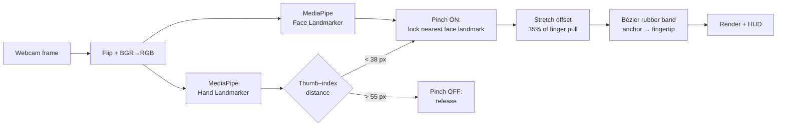

# Luffy Stretch 🫲

A real-time computer-vision toy inspired by rubber-band stretching: **pinch any point on your face with your thumb and index finger, pull, and a stretchy rubber "arm" follows your hand** through the webcam feed.

It runs entirely on your laptop's CPU using **Google MediaPipe** face and hand landmark models and **OpenCV**.


> 📸 _Demo GIF coming soon: add `docs/demo.gif` here._

---

## Features

- **478-point face mesh** and **21-point hand tracking** on every webcam frame
- **Pinch detection** with hysteresis (separate "on" and "off" thresholds) so the grab doesn't flicker
- **Nearest-landmark grab**: the pinch locks onto whichever face point is closest to your fingertip
- **Rubber-band rendering** with a quadratic **Bézier curve** that bends, thickens when relaxed and thins as you stretch it, plus a highlight line for a glossy look
- **Live HUD**: FPS, face found / not found, pinch distance, grabbed landmark id and stretch offset
- Mirrored camera view so movement feels natural

## How it works



1. **Detect**: each frame goes through MediaPipe's face and hand landmarker models.
2. **Pinch**: the distance between the thumb tip (landmark 4) and index tip (landmark 8) toggles the grab. Using 38 px to start and 55 px to release avoids jitter at the boundary.
3. **Anchor**: on pinch, the closest of the 478 face landmarks to your fingertip is locked as the anchor.
4. **Stretch**: a quadratic Bézier curve is drawn from the anchor to your fingertip. The control point bulges sideways (up to 200 px), and the band's thickness shrinks from 40 px toward 6 px as the pull gets longer, like real rubber.

## Controls

| Action | What happens |
|---|---|
| Pinch thumb + index near your face | Grabs the nearest face point |
| Move your hand while pinching | Stretches the rubber band |
| Open your fingers | Releases the grab |
| `Esc` | Quit |

## Project structure

```
luffy-stretch/
├── main.py                 # Webcam loop, pinch logic, HUD
├── config.py               # Pinch thresholds and band thickness settings
├── effects/
│   ├── bezier.py           # Rubber-band Bézier rendering
│   └── face_warp.py        # Stretch offset calculation
├── detectors/
│   ├── face_detector.py    # MediaPipe face landmarker wrapper
│   └── hand_detector.py    # MediaPipe hand landmarker wrapper
├── models/
│   ├── face_landmarker.task
│   └── hand_landmarker.task
└── test_mediapipe.py       # Quick check that MediaPipe imports work
```

## Run it locally

**Prerequisites:** Python 3.11 or 3.12 and a webcam.

```bash
git clone https://github.com/JayantBansal900/luffy-stretch.git
cd luffy-stretch

python -m venv venv
# Windows
venv\Scripts\activate
# macOS / Linux
source venv/bin/activate

pip install -r requirements.txt
python main.py
```

The two MediaPipe model files are included in `models/`. If they are ever missing, download them from Google's MediaPipe docs:
[face_landmarker.task](https://ai.google.dev/edge/mediapipe/solutions/vision/face_landmarker) and
[hand_landmarker.task](https://ai.google.dev/edge/mediapipe/solutions/vision/hand_landmarker).

### Tuning

Edit `config.py`:

| Setting | Default | Meaning |
|---|---|---|
| `PINCH_ON` | `38` | Fingertip distance (px) that starts a grab |
| `PINCH_OFF` | `55` | Fingertip distance (px) that releases it |
| `BASE_THICKNESS` | `40` | Band thickness when relaxed |
| `MIN_THICKNESS` | `6` | Thinnest the band gets when stretched |
| `MAX_BULGE` | `200` | Maximum sideways curve of the band |

## Roadmap

- [ ] Warp the actual face pixels (mesh deformation) instead of drawing an overlay
- [ ] Snap-back animation when the pinch is released
- [ ] Two-hand support
- [ ] Record clips straight to GIF / MP4

## Author

**Jayant Bansal** · [GitHub](https://github.com/JayantBansal900)
